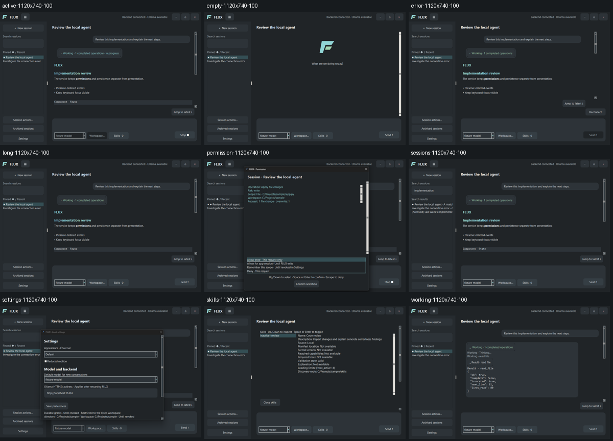

# FLUX GUI review — issue #54

Reviewed on Windows on 2026-09-30 using production widgets and deterministic
fixtures. The fixture checks were explicitly approved by the user. No personal
session database, real permission grant, or live model was used.

## Captured layouts

23 layouts were captured and inspected. Nine baseline screens are retained here;
the additional retained examples show constrained layouts and large text scaling.
Sizes below describe the requested client area. Native minimum-size handling
produced 916 × 639 for the 900 × 600 cases; fixture-created Settings windows
occasionally added 16 pixels to the main width during subsequent fixture resizing.
Separately opening Settings after restoring a mapped window preserved its exact
1120 × 740 size across three restart simulations.

| Requested size | Tk scaling | Screens inspected |
| --- | --- | --- |
| 1120 × 740 | 100% | All nine states |
| 900 × 600 | 150% | Active, permission, Settings, Skills, long content, sessions |
| 1366 × 768 | 125%, 200% | Empty, permission, Settings, long content |

Baseline screenshots: [empty](visual-fixtures/empty-1120x740-100.png),
[active](visual-fixtures/active-1120x740-100.png),
[Working](visual-fixtures/working-1120x740-100.png),
[permission](visual-fixtures/permission-1120x740-100.png),
[Settings](visual-fixtures/settings-1120x740-100.png),
[Skills](visual-fixtures/skills-1120x740-100.png),
[error](visual-fixtures/error-1120x740-100.png),
[long content](visual-fixtures/long-1120x740-100.png), and
[session search](visual-fixtures/sessions-1120x740-100.png).

Constrained examples: [permission at 150%](visual-fixtures/permission-900x600-150.png),
[permission at 200%](visual-fixtures/permission-1366x768-200.png),
[Skills at 150%](visual-fixtures/skills-900x600-150.png), and
[Settings at 125%](visual-fixtures/settings-1366x768-125.png).

## Findings and checks

- Rounded charcoal surfaces, selectable conversation text, compact context
  controls, empty welcome, session search/archive labels, expanded safe Working
  results, error guidance, and scrollable Settings/Skills were visually inspected.
- Large scaling collapses the sidebar; constrained Settings and Skills expose
  additional content by scrolling. Permission choices and confirmation remain
  fixed while the scope summary scrolls. Visual inspection exposed and corrected
  an earlier layout where the selected grant could scroll out of view.
- Native caption hit tests, all edge/corner hit codes, double-click maximize,
  maximize within the monitor work area, and minimize/restore passed. Actual
  Windows pointer gestures also passed: caption dragging moved the window,
  edge dragging resized it, and dragging to the left edge snapped it to half
  the usable display. These checks used the fixture window.
- Geometry restore and opening Settings passed three repeated exact-size checks.
  Native callbacks use cached layout, avoiding Tcl reentry during Windows frame
  dispatch. Child-window hit passthrough preserves native pointer gestures.
- The latest scoped automated batch passed 45 cases covering desktop widgets,
  parsing/contrast/platform policy, session persistence/search, service guards,
  preferences, and permission deadlines. Earlier scoped runs also covered schema
  migration and message-activity paging. After the final permission layout fix,
  all eight affected desktop widget cases passed again. No full discovery sweep
  was run.

## Verification limits

Tk scaling was changed for the screenshot matrix; Windows display scaling itself
was not changed. Physical DPI transitions, snap-layout hover menus, Alt+Space,
Windows file-picker integration, actual browser/Explorer launches, and screen-reader
behavior remain unverified. Automated checks cover keyboard permission selection,
dismissal, owner binding, drafts, stream recovery, safe links, and exit decisions;
those checks do not establish end-to-end live-model behavior. Live Ollama evaluation
was not run. The documented fixture workflow supports further review without
granting filesystem or model access.

## UI follow-up

The screenshots above record the initial design review and precede the user's
subsequent UI adjustments. The follow-up replaces the letterform mark with an open
geometric current, hides the outer chat scrollbar, uses a cyan arrow-only send
control, and introduces separate conversation cards with pin controls and three-dot
menus. The model dropdown is retained.

An inert fixture reproduced both reported bugs: a real maximize-button click left
the window normal, and stream delivery in a conversation with 18 earlier turns
blocked the UI for a maximum of 150.3 ms (139.3 ms mean). After retaining unchanged
turn widgets and batching queued events, the same fixture measured 21.5 ms maximum
and 14.4 ms mean. These are fixture measurements, not a general frame-rate guarantee.
The real maximize click then changed the window to zoomed. This reproduces the
failure independently of hosting, a backend service, or a running model.

19 targeted widget/design tests passed, including completed-widget retention,
bubble-wheel routing, batched streaming, row-owned pin/archive actions, and native
maximize release/cancellation. A broader affected run's result was not retained.
The user subsequently requested that no further tests open windows. Fixture capture
was stopped, and final screenshot refresh and additional GUI verification were
deferred. Future popup-producing checks require renewed authorization. Changes
made during the subsequent static review have not been rerun in a GUI.

Further user refinements restore a slim rounded chat scrollbar, distinguish the
titlebar with a blue-charcoal surface, compact search into an in-field magnifier
placeholder, and add sidebar transitions. Resize handling now reflows existing
embedded text instead of rebuilding it. Twelve window-free checks passed for
contrast, deterministic animation/reduced-motion behavior, resize scheduling,
preserving text/widgets during reflow, search hints, and the prior platform policies.
No GUI windows were opened for these checks; visual smoothness, scrollbar interaction,
and the updated screen layouts await a separately authorized visual review.

The next refinement replaces model and session-action popups with rounded inline
menus, aligns font families and selector hover states, adds an inline assistant
mark and composer placeholder, and moves the sidebar toggle to a persistent rail.
Window-free regressions identified redundant Tcl dimension reads and caption-tree
queries during layout; caching and event filtering remove those operations.
Twenty-one window-free checks passed. Updated layouts and actual mouse-resize
frame timing remain unverified; no popup-producing checks were run.

The user subsequently authorized headed and hidden performance checks. A mapped,
backend-free fixture with 25 turns reproduced combined resize/scroll paint work
averaging 706.6 ms with a 1240.3 ms maximum. Larger rounded paint tiles, selective
Windows hit hooks, reduced full-client invalidation, deferred offscreen reflow,
and immediate automatic sidebar adaptation substantially reduce that workload.
An intermediate 96-sample check measured resize mean 47.7 ms / p95 93.6 ms, scroll
mean 33.5 ms / p95 66.7 ms, and combined mean 66.7 ms / p95 90.6 ms. Its 100-ms
p95 regression ceiling guards against the reproduced stalls, not a 60-fps claim.
The check verifies visibility after each sample, maximize/restore, compact model
control size, inline menu opening, and matching titlebar/rail colors. No model,
backend, real conversation data, or pointer movement is involved. An experimental
repaint-suppression approach was discarded because visibility checks exposed an
incorrect fast result. These measurements use a fixture rather than the user's
live sessions; the historical screenshot gallery has not been refreshed.

Breakpoint hysteresis then removed repeated sidebar collapse/reopening during
resize. The final 96-sample visible fixture measured resize mean 29.0 ms / p95
45.4 ms, scroll mean 20.2 ms / p95 40.4 ms, and combined mean 47.3 ms / p95
63.4 ms. Combined maximum was 66.4 ms; resize had an isolated 123.5-ms peak.
These results substantially reduce the reproduced stalls without promising a
constant 60 fps. The fixture regression and 26 focused widget/design checks pass.
An affected-test rerun also passed: resize mean 55.9 ms / p95 80.8 ms, scroll
mean 33.1 ms / p95 96.3 ms, and combined mean 53.4 ms / p95 75.6 ms. Timing
varies with desktop load; the combined workload remains roughly thirteen times
faster than the original measured mean. The regression lives in
`tests/test_desktop_performance.py` and opens one fixture window when authorized.

The next refinement places a muted rounded model chevron at the control's right
edge, enlarges the send glyph in a tighter button, draws the search magnifier,
refreshes Side Panel hints on toggling, and bridges native maximize hover to the
shared ttk active state. Whole-interface zoom supports Ctrl+wheel, Ctrl+plus/minus,
and Ctrl+0, with bounded persisted percentages. Fixture checks exercised all zoom
levels and repeated resets, icon placement, dropdown reopening, draft and turn-widget
retention, live hint updates, and Ctrl-wheel consumption. API checks covered restart
persistence and invalid zoom values. Thirty functional checks passed in the affected
run. Its resize timing check failed the 100-ms p95 cutoff (69.4-ms mean, 135.4-ms
p95); a standalone rerun also exceeded it (54.4-ms mean, 113.7-ms p95). Smooth
performance remains variable and is not claimed fully resolved. No live model or
actual OS DPI change was used, and the screenshot gallery remains historical.
